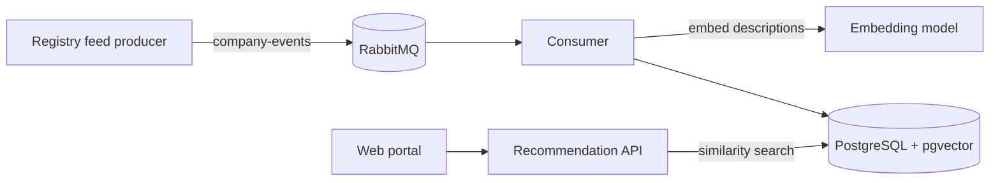

# SimilarCo: Company Similarity Recommender

SimilarCo powers a **"Similar companies"** panel for a company directory. When a user opens a company's page, SimilarCo returns the companies whose business activities are most alike, so the user can discover peers, suppliers and competitors in the same industry.

It is an event-driven service: company updates stream in through a message queue, each company's business description is turned into a semantic embedding, and similarity search runs inside PostgreSQL with pgvector.

> Built from a take-home brief by OneCredit's Data & AI team. All data is synthetic.

## How it works



1. **Ingest:** the registry publishes every company change to the `company-events` queue in RabbitMQ.
2. **Embed:** the consumer reads each event and converts the company's *nature of business* into a vector with an open-source embedding model running locally on CPU.
3. **Store:** the company and its vector are saved in PostgreSQL using the pgvector extension.
4. **Recommend:** the API takes a company's registration number and returns its nearest neighbours, most similar first, with the details needed to draw each card.

### Real-world data challenges handled

The incoming feed is unvalidated and merged from several sources, so the consumer is designed to cope with:

- **Duplicate deliveries:** the queue delivers at least once, so the same message can arrive more than once.
- **Out-of-order updates:** an older change can arrive after a newer one. Each event's `updatedAt` decides which version wins, not arrival order.
- **Messy records:** missing fields, empty descriptions and mixed English/Malay text.
- **No lost companies:** every company in the feed must appear on its own page and in others' recommendations.

## Tech stack

| Area | Tools |
|---|---|
| Language | Python 3.14, managed with uv |
| Messaging | RabbitMQ 3.13 |
| Database | PostgreSQL 16 + pgvector |
| Embeddings | Open-source local model (to be finalised in `DESIGN.md`) |
| Infrastructure | Docker Compose, just |

## Getting started

### Prerequisites

- [Docker Desktop](https://www.docker.com/products/docker-desktop/) (must be running)
- [uv](https://docs.astral.sh/uv/)
- [just](https://just.systems/)

### Start the infrastructure

```bash
just setup     # install Python dependencies
just up        # start PostgreSQL (with pgvector) and RabbitMQ
just publish   # replay the company feed onto the queue
```

| Service | Address | Login |
|---|---|---|
| PostgreSQL | `localhost:5432`, database `companies` | `postgres` / `postgres` |
| RabbitMQ UI | http://localhost:15672 | `guest` / `guest` |

Ports can be changed with `POSTGRES_PORT`, `RABBITMQ_PORT` and `RABBITMQ_UI_PORT`.

Each `just publish` resends the whole feed. To start from a clean state, run `just down` and then `just up`.

### Run the consumer

_Coming soon._

### Run the recommendation API

_Coming soon._

### Run the tests

_Coming soon._

## Project structure

```
data/feed.jsonl        Synthetic feed: 2,518 messages about 2,000 companies (includes duplicates)
producer/publish.py    Replays the feed onto the company-events queue
docker-compose.yml     PostgreSQL + pgvector and RabbitMQ
Justfile               Shortcut commands (setup, up, publish, down)
DESIGN.md              Design decisions, assumptions, scaling plan and open items (coming soon)
```

## Notes

- All company data is synthetic. `SYN-` registration numbers are not real SSM numbers.
- On some Intel Macs, RabbitMQ fails to start with `.erlang.cookie: eacces`. A local, gitignored `docker-compose.override.yml` that mounts `/var/lib/rabbitmq` as tmpfs fixes it; queue data then does not survive a container restart, so re-run `just publish` if needed.
